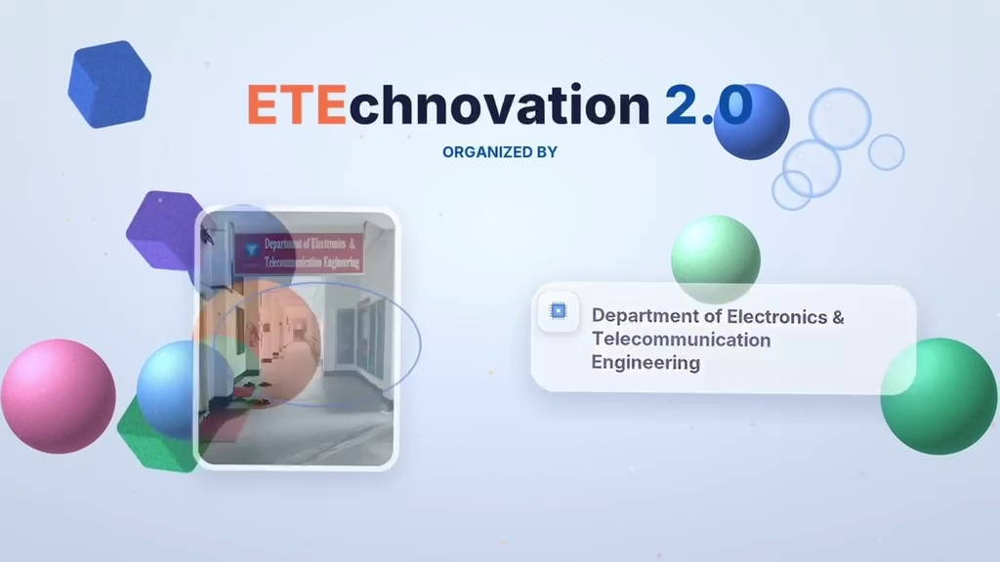

# ETEchnovation 2.0 — Campus Ambassador Recruitment Portal

Official Campus Ambassador (CA) Recruitment website for **ETEchnovation 2.0** — the flagship National Technology Carnival organized by the **Department of Electronics and Telecommunication Engineering (ETE)** at **Rajshahi University of Engineering & Technology (RUET)**.



---

## 🌟 Highlights & Features

- **Dynamic Hero & Festival Countdown**: Real-time countdown timer to the grand carnival in February 2027.
- **Cinematic 16:9 Promo Video Player**: High-definition video player showcasing the festival teaser with custom playback controls.
- **Interactive Poster Showcase**: Full zoomable lightbox and direct high-resolution poster download.
- **4-Step Wizard Application Form**:
  - Step 1: Personal Details (Name, Contact, Gender, T-Shirt Size)
  - Step 2: Academic Background (Institution, Department, Year, Student ID, City)
  - Step 3: Social & Ambassador Profile (Facebook, LinkedIn, Club Leadership, Skills)
  - Step 4: Motivation & Campaign Vision (Vision, On-Campus Outreach Strategy)
- **Live Google Sheets Cloud Integration**: Automatically submits form entries to Google Sheets via Google Apps Script Web App.
- **Redundant Local Storage**: Saves applications locally in `localStorage` in case of offline network drops.
- **Instant Digital Ambassador Pass**: Generates a downloadable / printable unique candidate ticket with ID (e.g., `ETE27-CA-XXXX`).
- **Interactive Confetti Celebration**: Canvas-driven celebratory particle effects upon successful submission.
- **Hidden Admin Management Portal**:
  - Kept private from public visitors.
  - Access via organizer shortcut <kbd>Ctrl</kbd> + <kbd>Shift</kbd> + <kbd>A</kbd> or URL query `?admin=true`.
  - Filter applicants by university, department, and status.
  - One-click CSV export of all candidates.
- **Dual Theme Support**: Cyber Tech Dark Mode & Vibrant Carnival Light Mode.
- **Fully Mobile Responsive**: Optimized for phones, tablets, and desktops with touch-friendly controls.

---

## 🚀 Live Demo & Local Setup

### Running Locally

You can serve this project with any standard local HTTP server:

```bash
# Using Python
python -m http.server 3000

# Using Node.js
npx serve .
```

Open `http://localhost:3000` in your web browser.

---

## 📁 Project Structure

```
├── index.html          # Main recruitment landing page and wizard form
├── styles.css          # Design system, responsive layouts & micro-animations
├── app.js              # Application logic, validation, Google Sheets sync & admin portal
├── final banner.jpeg   # Official Campus Ambassador recruitment banner
├── assets/
│   ├── final-banner.jpeg   # Official recruitment banner
│   ├── promo-video.mp4     # Official carnival promo video (16:9)
│   ├── video-poster.jpg    # Video cover thumbnail
│   └── ...
└── README.md
```

---

## ⚙️ Google Sheets Integration Setup

The website connects to a Google Sheet via Google Apps Script (`doPost` webhook).

1. In your Google Sheet, navigate to **Extensions** > **Apps Script**.
2. Paste the `doPost(e)` script handling incoming JSON data.
3. Deploy as a **Web App**:
   - **Execute as**: `Me`
   - **Who has access**: `Anyone`
4. Update `GOOGLE_SHEETS_ENDPOINT` in [app.js](app.js) with your deployment URL.

---

## 🏛️ Organized By
**Department of Electronics and Telecommunication Engineering (ETE)**  
**Rajshahi University of Engineering & Technology (RUET)**  
Rajshahi-6204, Bangladesh.
